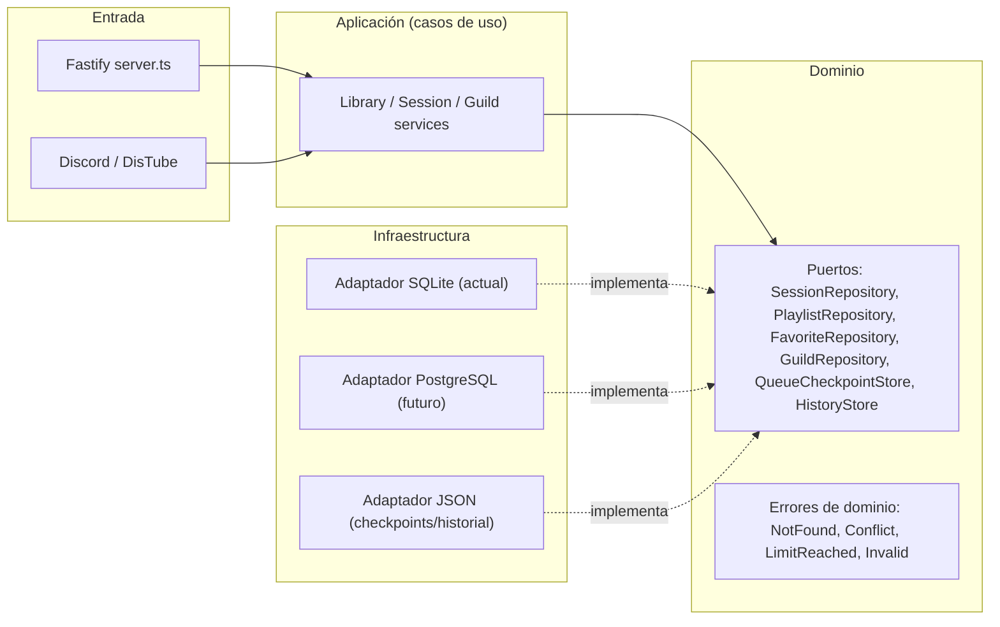
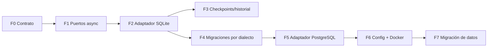

# Plan: desacoplar la persistencia de SONORA y preparar PostgreSQL

## 0. Opinión rápida

**Sí vale la pena desacoplar ya; migrar a PostgreSQL todavía no es urgente.**

- SQLite con WAL en un solo proceso aguanta muchos más servidores de los que el audio puede atender. El cuello de botella real de un bot público será **YouTube/yt-dlp (bloqueos por IP, 403, límites), CPU de FFmpeg y ancho de banda**, no la base de datos.
- PostgreSQL se vuelve **necesario** cuando haya **más de un proceso escribiendo**: shards de Discord (obligatorios a partir de 2 500 servidores), el panel web en un contenedor separado o réplicas.
- Desacoplar (puertos + adaptadores) es barato, no cambia el comportamiento y deja la migración lista para cuando haga falta.

> [!IMPORTANT]
> El mayor cambio no será SQL → PostgreSQL, sino **síncrono → asíncrono**. Hoy `better-sqlite3` es síncrono: [`WebDatabase`](../src/web/database.ts#L25-L149) comprueba límites (100 playlists, 500 pistas, 1 000 favoritos) y escribe sin que nada se intercale. Con PostgreSQL (asíncrono) esas comprobaciones pasan a ser **condiciones de carrera** si no se hacen dentro de una transacción con bloqueo.

## 1. Estado actual (lo que hay que desacoplar)

| Pieza | Dónde | Acoplamiento |
| --- | --- | --- |
| Sesiones, usuarios, playlists, favoritos | [database.ts](../src/web/database.ts), [schema.ts](../src/web/schema.ts) | Clase concreta con Drizzle + `better-sqlite3`, métodos síncronos, lanza `WebError` (HTTP) desde la capa de datos |
| Migraciones | [0001_dashboard.sql](../migrations/0001_dashboard.sql) + runner en [`openWebDatabase`](../src/web/database.ts#L151-L166) | Una sola versión, cableada a SQLite |
| Consumidor | [server.ts](../src/web/server.ts#L66) | Llama a `database.*` sin `await`; cierra con `database.sqlite.open` ([L768](../src/web/server.ts#L768)) |
| Checkpoints de cola | [queueRecovery.ts](../src/music/queueRecovery.ts#L83) | Archivo `data/queues.json` |
| Historial | [history.ts](../src/music/history.ts#L134) | Archivo JSON |
| Lista blanca de servidores | [config.ts](../src/web/config.ts#L35) | `WEB_ALLOWED_GUILD_IDS` en `.env` |
| Pruebas | `test/*.test.js` usan `openWebDatabase(':memory:')` | Dependen de la clase concreta |

## 2. Arquitectura objetivo



Estructura sugerida (sin mover el resto del proyecto):

```text
src/
  domain/persistence/      # tipos (WebUser, SavedPlaylist, TrackMetadata), puertos e errores de dominio
  infrastructure/sqlite/   # adaptador actual (schema.ts, migraciones, repositorios)
  infrastructure/postgres/ # adaptador futuro
  runtime/                 # composition root: elige adaptador según config
```

Regla: **`server.ts` y `src/music/` solo importan de `domain/`**, nunca de `drizzle-orm` ni `better-sqlite3`.

## 3. Fases (un PR por fase, cada una sin romper nada)

### Fase 0 — Pruebas de contrato (red de seguridad)
Antes de tocar código, fijar el comportamiento actual con una suite reutilizable `test/contracts/repositories.contract.js` que reciba una fábrica de repositorios:

- Sesiones: crear, rotar (borra las previas del usuario), expirar, `purgeExpired`, retiro de sesiones con CSRF legado, rechazo de tokens con formato inválido.
- Playlists: límite 100, límite 500 pistas, 404 por usuario/servidor ajeno, renombrar, borrar en cascada, `reorder` exige todos los ids exactamente una vez, borrar pista recompacta posiciones.
- Favoritos: deduplicación por URL, límite 1 000, 404 al borrar ajenos.
- **Aislamiento**: usuario A no ve datos de B; servidor X no ve datos de Y.
- Miniaturas: saneamiento con `sanitizeThumbnailUrl`/`youtubeThumbnail`.

**Criterio de salida:** la suite pasa contra `WebDatabase` actual sin modificar producción.

### Fase 1 — Puertos y errores de dominio (asíncronos desde el inicio)
- Crear interfaces con firmas `Promise<...>` aunque SQLite siga siendo síncrono. Así el cambio síncrono → asíncrono ocurre **una sola vez y con SQLite**, donde es fácil depurar.
- Sustituir `WebError(404|409|400)` en la capa de datos por errores de dominio; `server.ts` los traduce a HTTP en un único `setErrorHandler`.
- Agrupar en un objeto `Repositories { sessions, playlists, favorites, guilds, close(), health() }`.

**Criterio de salida:** compila; ningún cambio de comportamiento.

### Fase 2 — Adaptador SQLite + inyección en el servidor
- Mover `WebDatabase` a `infrastructure/sqlite/` implementando los puertos.
- `buildServer({ repositories })` en lugar de `database`; el composition root ([webDashboard.ts](../src/runtime/webDashboard.ts)) crea el adaptador.
- Añadir `await` en todos los usos de [server.ts](../src/web/server.ts) (L96, L167, L313–355, L613–751).
- Mantener `openWebDatabase` como alias temporal para no romper `test/*.test.js` y `dashboard-preview.cjs`.

> [!WARNING]
> Al introducir `await` aparecen nuevos puntos de intercalado. Conservar el invariante de `AGENTS.md`: **revalidar sesión, membresía y rol después de cada espera** (por ejemplo, en la importación de playlists de [L655](../src/web/server.ts#L655)).

**Criterio de salida:** `npm run build`, `npm test` (509 + 221) y la suite de contrato en verde.

### Fase 3 — Checkpoints e historial detrás de puertos (opcional, recomendable)
- `QueueCheckpointStore` y `HistoryStore` con adaptador JSON actual (misma escritura atómica `tmp` + `rename`, `mode 0o600`).
- Imprescindible antes de tener varios procesos: los archivos JSON no se comparten entre shards.

### Fase 4 — Migraciones por dialecto
- `migrations/sqlite/0001_dashboard.sql` (actual) y `migrations/postgres/0001_dashboard.sql`.
- Runner propio versionado (tabla `web_migrations`), transaccional, que **nunca** ejecute DDL destructivo sin autorización.
- Esquema PostgreSQL con `drizzle-orm/pg-core`:
  - Marcas de tiempo en ms → `bigint` con `mode: 'number'` (`integer` de PG es 32 bits y se desborda).
  - Ids y snowflakes de Discord → `text`.
  - `playlist_tracks(playlist_id, position)` → `UNIQUE ... DEFERRABLE INITIALLY DEFERRED` para reordenar sin el truco de posiciones negativas (o conservar el truco dentro de la transacción).

### Fase 5 — Adaptador PostgreSQL
- `drizzle-orm/node-postgres` con `pg.Pool` (tamaño configurable, `statement_timeout`).
- Equivalencias que cambian:
  - `result.changes` → `rowCount`.
  - `onConflictDoNothing` en favoritos → `INSERT ... ON CONFLICT (user_id, guild_id, url) DO NOTHING RETURNING *` y, si no devuelve fila, leer la existente.
  - Límites (100 / 500 / 1 000) y posición al añadir pista → dentro de una transacción con `SELECT ... FOR UPDATE` sobre la playlist o `pg_advisory_xact_lock(hash(user_id, guild_id))`.
- Ejecutar **la misma suite de contrato** contra PostgreSQL:
  - Local/unitario: `@electric-sql/pglite` (PostgreSQL en memoria, sin Docker; Drizzle lo soporta).
  - CI: servicio `postgres:17` en GitHub Actions.
- Añadir pruebas de concurrencia (p. ej. 20 `addFavorite` simultáneos no superan el límite ni duplican).

### Fase 6 — Configuración y Docker
- `DATABASE_DRIVER=sqlite|postgres` (por defecto `sqlite`) y `DATABASE_URL` (secreto: nunca en logs ni en el cliente).
- Servicio `postgres` en [docker-compose.yml](../docker-compose.yml) bajo un `profile` opcional, con `healthcheck` y volumen.
- Cierre ordenado: `repositories.close()` en `onClose`.

### Fase 7 — Migración de datos SQLite → PostgreSQL
- Script idempotente con `--dry-run`, por lotes, en una transacción por tabla, que verifique conteos y checksums.
- **Copia de seguridad previa del `.db`** y del volumen; el archivo SQLite queda intacto como rollback.
- Corte: detener bot → migrar → verificar → arrancar con `DATABASE_DRIVER=postgres`. Rollback: volver a `sqlite`.

## 4. Pista paralela: preparar el uso público

Independiente de PostgreSQL; conviene planificarla aparte:

| Tema | Acción |
| --- | --- |
| Acceso | Sustituir la lista blanca `WEB_ALLOWED_GUILD_IDS` por un modo `open` + `guild_settings` en BD (rol DJ, canal del panel, volumen por defecto) |
| Abuso | Límites por usuario y por servidor (búsquedas, `play`, importaciones), cuotas de playlists por servidor |
| Privacidad | Política de privacidad, comando para exportar/borrar datos del usuario; definir qué hacer en `guildDelete` (borrado = acción destructiva → requiere política explícita) |
| Discord | Verificación del bot al acercarse a 100 servidores; justificar intents privilegiados; sharding a partir de 2 500 |
| Audio | Riesgo de bloqueo de IP y términos de servicio de YouTube (motivo del cierre de Groovy y Rythm); valorar proxys/IPs, Lavalink o fuentes alternativas |
| Operación | Métricas por servidor, alertas, backups automáticos, y coste de CPU/ancho de banda por conexión de voz |

## 5. Orden recomendado



- **Ahora:** F0 → F2 (sin cambio de comportamiento, gran valor).
- **Cuando haya necesidad real** (shards, web separada, réplicas): F3 → F7.

## 6. Reglas para agentes que implementen este plan

- **Una fase por rama/PR**, empezando por F0. Leer antes `AGENTS.md` y `docs/LIBRARY_EDITOR_INVARIANTS.md`.
- Validación obligatoria por PR: `npm run lint`, `npm run format:check`, `npm run build`, `npm test` y `git diff --check` en verde.
- Sin `push`, `merge`, `start`, `dev` ni despliegues sin autorización explícita del mantenedor.
- Prohibido en F0–F2: cambiar contratos HTTP de [contracts.ts](../src/web/contracts.ts), el esquema de SQLite, los límites o los mensajes de error visibles.
- No leer ni editar `.env`; `DATABASE_URL` es un secreto y nunca debe aparecer en logs ni en el cliente.
- En cada revisión responder: “¿dónde hay un `await` nuevo entre una comprobación y una escritura?”.
- Al terminar una fase, actualizar la tabla de progreso.

## 7. Progreso

| Fase | Estado | PR |
| --- | --- | --- |
| F0 Pruebas de contrato | Hecho (pendiente de PR) | — |
| F1 Puertos asíncronos y errores de dominio | Hecho (pendiente de PR) | — |
| F2 Adaptador SQLite + inyección | Hecho (pendiente de PR) | — |
| F3 Checkpoints e historial detrás de puertos | Hecho (pendiente de PR) | — |
| F4 Migraciones por dialecto | Hecho (pendiente de PR) | — |
| F5 Adaptador PostgreSQL | Hecho (pendiente de PR) | — |
| F6 Configuración y Docker | Pendiente | — |
| F7 Migración de datos | Pendiente | — |
